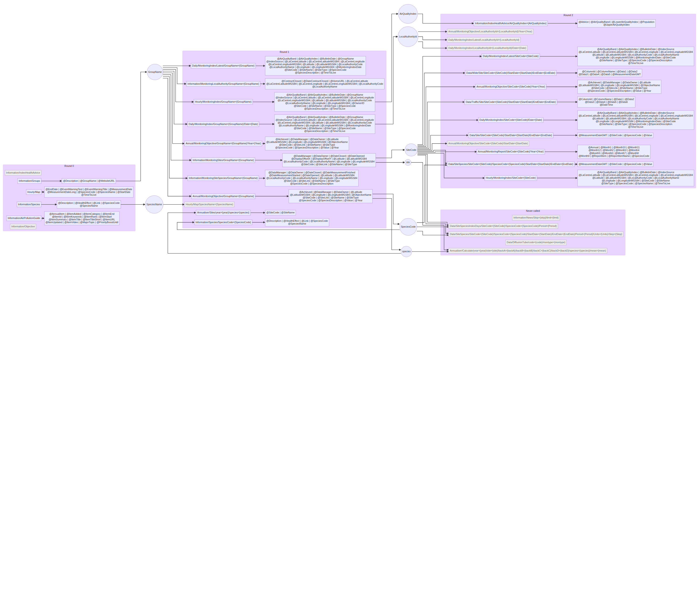

# London's air, on repeat: NO₂ beside a main road

## What I built and who for

**Audience:** people who walk, cycle or wait for buses along central London's main roads, and the people who
advise them.

**Question:** how much worse is the air right beside a busy road than nearby, and at what time of day?

**What I built:**

1. **An exploration of the London Air Quality API** ([Explore.ipynb](Explore.ipynb)) that starts from the help page,
   discovers how the endpoints connect, records the schema of every reply, and draws a map of the whole API.
2. **A pipeline** ([pipeline.py](pipeline.py)) that collects hourly nitrogen dioxide (NO₂) for two sites into DuckDB.
   Every run adds only new data and never creates duplicates.
3. **An analysis** ([Analyse.ipynb](Analyse.ipynb)) comparing the two sites:
   - **Marylebone Road (MY1):** kerbside, on one of London's busiest roads
   - **Station Walk, Kensington (GT1):** urban background, about 4 km away

**Headline (1 Aug – 29 Oct 2026):** beside Marylebone Road, NO₂ averaged **4.1×** the background level. The gap is
largest at **16:00 GMT**. The road was above the WHO daily guideline (25 µg/m³) on **68 of 70** measured days; the
background site on **7 of 89**.

## The data

The [London Air Quality Network API](https://api.erg.ic.ac.uk/AirQuality/help), run by the Environmental Research Group.

### How the endpoints connect



Generated by [Explore.ipynb](Explore.ipynb) from what it found (source: [api_map/map.mmd](api_map/map.mmd); open
[api_map/map.html](api_map/map.html) in a browser to zoom). Columns are the rounds in which each endpoint could first
be called; each endpoint points to the fields it returns; each circle is a parameter, fed by the endpoint that lists
its values and pointing to every endpoint that needs it. Grey endpoints never returned data.

**The path this project uses:**

```
Information/Groups           → GroupName  ("London")
Information/MonitoringSites  → SiteCode   ("MY1", "GT1")
Information/Species          → SpeciesCode ("NO2")
Data/SiteSpecies (SiteCode, SpeciesCode, StartDate, EndDate) → hourly readings
```

### How the exploration works

1. Read the help page's table with `pandas.read_html`, keep the 36 JSON endpoints, and take each endpoint's
   parameters from the `{...}` in its URL.
2. Start knowing only the calendar (dates and years, which I choose).
3. Each round, call every endpoint whose parameters all have known values (up to 3 sample values each).
   `json.loads(..., object_hook=Harvest)` reads every part of each reply: it records the fields returned and keeps
   any value that fills a parameter. `genson` merges the samples into one schema.
4. Stop when a round has nothing new to call. Result: 3 rounds, 31 endpoints called, 24 returned data.

### Problems found in the API, and how each was handled

| Problem | How it was handled |
|---|---|
| No machine-readable spec (no OpenAPI or WSDL) | Read the help page's HTML table with `pandas.read_html` |
| Every endpoint listed in several formats (XML, JSON, CSV, PDF) | Kept only the `/Json` endpoints |
| Parameters are hidden inside URL templates | A regex takes the names inside `{...}` |
| You cannot call an endpoint without values that only other endpoints return | The crawl: start from the calendar and the parameter-free endpoints, round by round |
| The same thing has different names (`@LocalAuthorityCode` fills `LocalAuthorityId`; the Annualiser uses `site`, `species`) | A hand-written alias table of 3 entries |
| Every endpoint nests its reply differently | `object_hook` reads every dict at any depth, with no per-endpoint paths. A regex over the text was tried and rejected as brittle. |
| Replies contain their own `@StartDate` / `@Year` fields, which overwrote the dates I chose | Calendar parameters are never replaced by harvested values |
| Values with spaces (`Nitrogen Dioxide`) broke URLs | `urllib.parse.quote` makes every value URL-safe |
| One item comes back as an object, several as a list (e.g. a site's `Species`) | `genson` merges samples, so the schema records both shapes; the pipeline turns a single object into a list |
| A site with no current data is answered three ways: HTTP 400, a bare `null`, or an empty list | Three spread-out samples per endpoint; results like "1 of 3 ok" are reported, not hidden |
| `Information/IndexHealthAdvice` and `Information/Objective` fail (HTTP 400) with no parameters | Recorded as broken, not used |
| 5 endpoints can never be called: no reply ever supplies `backA`–`backD`, `mean`, `code`, `montype`, `Period`, `Units`, `Step`, `skip`, `limit` | Listed; they need the API's documentation PDF |
| `Hourly/Map/SpeciesName=` fails with a species name but works with a species code | Recorded |
| Every value is a string, even numbers and dates; missing values are `""` | Types are declared when shaping the data; `""` becomes NULL |

## How it works

### The pipeline

```
API ──► extract (GetSites, GetReadings) ──► shape (types) ──► load (upsert into DuckDB, log the run)
```

Settings at the top of [pipeline.py](pipeline.py): `GROUP = "London"`, `SITES = ["MY1", "GT1"]`, `SPECIES = "NO2"`,
`DAYS_BACK = 7`. Changing the place or pollutant is a one-line change.

### The data model

```
sites    (site_code PK, site_name, site_type, latitude, longitude, date_closed)
readings (site_code, species_code, measured_at, value)    PK = (site_code, species_code, measured_at)
runs     (run_at, days_back, new_rows, total_rows)
```

- **One row of `readings` = one site, one pollutant, one hour.** Adding a site adds rows, not columns.
- **The primary key is what prevents duplicates.**
- **`value` is NULL** when the hour has no reading yet.
- **Units:** µg/m³. The API does not say; this is the unit the network reports NO₂ in, so it is an assumption.

### What happens when it runs again

Each run re-fetches the last 7 days and **upserts** them:

```sql
INSERT INTO readings SELECT * FROM NewReadings
ON CONFLICT (site_code, species_code, measured_at) DO UPDATE SET value = excluded.value
```

A new hour is inserted. An hour already stored is updated in place: a late reading replaces its NULL, and a corrected
(ratified) value replaces the provisional one. The row count never grows from re-running, and the `runs` table
records how many rows each run added.

### Problems found in the data, and how each was handled

| Problem | How it was handled |
|---|---|
| `EndDate` is exclusive | The end date is tomorrow, so today is included |
| Readings arrive late and out of order (e.g. 10:00 and 11:00 present, 08:00 and 09:00 not yet), and are corrected later | Missing hours are kept as NULL, the last 7 days are re-fetched every run, and the upsert fills them in |
| The upsert keeps only the latest value of each hour | A named limitation (see *What I would do next*) |
| The London site list has 254–255 rows but 251 site codes (HS1 and HS5 listed three times) and changes from day to day | `site_code` is the primary key; `INSERT OR REPLACE` keeps one, up-to-date row per site |
| The first background site chosen, Bloomsbury (BL0), has no NO₂ after 3 October 2026 | Checked each site's latest reading; switched to Station Walk (GT1, 99% of hours measured) |
| `@LatitudeWGS84` / `@LongitudeWGS84` are not degrees, despite the name (e.g. `6717454.58`) | Use `@Latitude` / `@Longitude` |
| Marylebone Road has values for 76% of hours, Station Walk for 99% | The analysis compares only hours where both sites have a reading, and counts a day only with at least 18 hours |
| DuckDB ignores case, so a DataFrame called `Sites` was read as the empty table `sites` | DataFrames are given names unlike any table |
| Being kind to the API | Exploration replies are cached on disk and calls are spaced 1 second apart |

### How these problems were found

Almost none came from cleverness. Each came from a cheap check comparing what I expected with what I got:

- **Count vs distinct count** showed the repeated site codes.
- **The latest timestamp per site** showed BL0 had stopped.
- **Counting missing values and looking at the newest rows** showed late, out-of-order readings.
- **Counting the types of one field** showed the object-or-list quirk.
- **Checking whether values are plausible** (min / max) showed the coordinates are not degrees.
- **Logging every call's result** showed the broken endpoints and the three ways of saying "no data".

The general method: profile every column (types, missing values, distinct values, min / max, real rows), write each
assumption as a check that fails loudly, and log every external call. *What would have to be true for my code to be
right? Check each of those things.*

## How to run it

```bash
python -m venv .venv && source .venv/bin/activate        # Windows: .venv\Scripts\activate
pip install -r requirements.txt

python -c "import pipeline; pipeline.Main(DaysBack=90)"   # once: backfill 90 days of history
python pipeline.py                                       # every day: adds only new data
```

Then open [Analyse.ipynb](Analyse.ipynb) for the analysis, or [Explore.ipynb](Explore.ipynb) to re-run the
exploration (its replies are cached in `api_cache/`, which is not committed).

## What I would do next

- **Keep every version of a reading (append-only).** Store each value with when it was fetched and insert a new row
  only when an hour is new or its value has changed. Re-runs would still add nothing, nothing would ever be lost, and
  "what did we know on date X?" becomes a query.
- **Run the pipeline on a schedule** (cron) instead of by hand.
- **More road / background pairs, and PM2.5,** to test whether the pattern holds across London.
- **Reach the 5 endpoints the crawl cannot** by reading the API's documentation PDF for their parameters.
- **A small dashboard or map** so the audience can choose their own sites and dates.

## Where AI helped

*To be written by me, in my own words.*

---

Data: London Air Quality Network, Environmental Research Group ([londonair.org.uk](https://www.londonair.org.uk)),
used under the API's terms and conditions.
