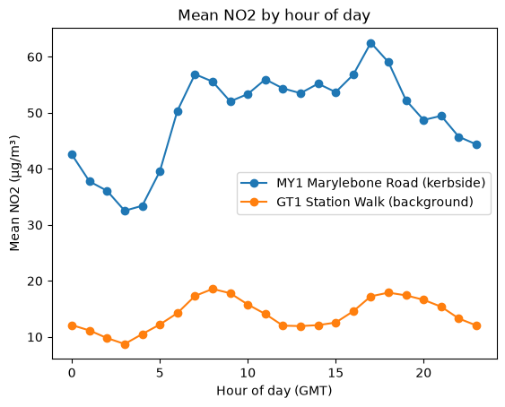
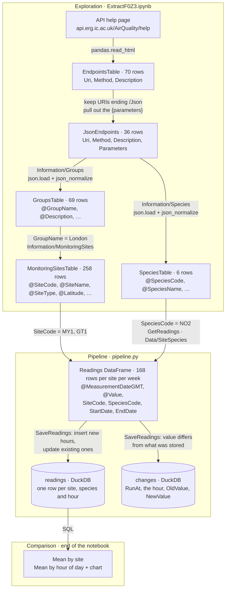

# London's air, on repeat: NO₂ beside a main road

## What I built and who for

**Audience:** people who walk, cycle or wait for buses along central London's main roads, and the people who
advise them.

**Question:** how much worse is the air right beside a busy road than nearby, and at what time of day?

**What I built:**

1. **An exploration of the API** ([ExtractF0Z3.ipynb](ExtractF0Z3.ipynb)). It starts from the API's help page, works
   out which endpoint gives the values another endpoint needs, and ends at the hourly readings.
2. **A pipeline** ([pipeline.py](pipeline.py)) that fetches the last 7 days of hourly NO₂ for two sites into DuckDB.
   Every run adds new hours, updates hours already stored, never duplicates, and records any value that changed.
3. **A comparison of the two sites** (end of the notebook):
   - **Marylebone Road (MY1):** kerbside
   - **Station Walk (GT1):** urban background

   Both site types come from the API's site list (`@SiteType`).

**Headline (17 Oct – 1 Nov 2026):** beside Marylebone Road, NO₂ averaged **3.6×** the background level, over the 304
hours when both sites had a reading. The gap is largest at **17:00 GMT** (62.5 against 17.2 µg/m³).



## The data

The [London Air Quality Network API](https://api.erg.ic.ac.uk/AirQuality/help), run by the Environmental Research
Group. Readings are hourly, in µg/m³: the API's `Data/Wide/Site` endpoint labels its NO₂ column
"Nitrogen Dioxide (ug/m3)".

A reading the API doesn't have yet comes back as an empty string (`""`). The pipeline stores it as missing (NULL), and
a later run fills it in when the value arrives.

## How it works

Each box is a table and each arrow is the code that makes the next one. The exploration notebook finds the path
through the API. `pipeline.py` repeats the last part of that path on every run.



### Where each step of the brief happens

| Step | Where | How |
|---|---|---|
| **Extract:** how the endpoints connect | the notebook | Help page → table of endpoints and their parameters → call the ones we can → each reply gives the values (GroupName, SiteCode, SpeciesCode) that unlock the next, until we reach the readings |
| **Collect history** | `pipeline.py`: `SaveReadings` | The `readings` table's primary key is site + species + hour, so each hour is stored once. A new hour is inserted. An hour we already have is updated (`ON CONFLICT … DO UPDATE`), which picks up late and corrected values. Before updating, any value that differs is written to `changes` with its old and new value. Each run re-fetches the last 7 days. |
| **Shape** | the `readings` table | Text from the API becomes a timestamp and a number by the table's column types. `""` becomes NULL (`NULLIF`). Every row carries the site and species it belongs to. |
| **Use** | end of the notebook | Mean NO₂ by site, and by hour of day, for the two sites. |

### Running it again

Running the pipeline twice in a row adds nothing the second time. To show it working over time, the notebook replays
a week: it moves the end date forward one day at a time, starting a week ago. The first run adds 336 hours (2 sites ×
7 days × 24 hours). Each run after that adds 48 (1 new day × 24 hours × 2 sites) and leaves the rest as they were.

A replay uses today's version of past data, so it can't show a late correction arriving. Real runs a few hours apart
do: the most recent hours are often empty at first and filled in later, and those show up in `changes`.

## How to run it

```bash
python -m venv .venv && source .venv/bin/activate        # Windows: .venv\Scripts\activate
pip install -r requirements.txt

python pipeline.py                                       # each run: fetch the last 7 days and save
```

Then open [ExtractF0Z3.ipynb](ExtractF0Z3.ipynb) for the exploration, the replay and the comparison. Close the
notebook's database connection (`Database.close()`) before running `pipeline.py`, because DuckDB lets only one program
write to `air.duckdb` at a time.

## What I would do next

- **Measure how far back values change.** The pipeline assumes nothing older than 7 days changes. Re-fetching an
  older month and comparing it with what was stored would turn that assumption into a measured number.
- **Know which site × pollutant pairs have data.** Asking for a pollutant a site doesn't measure returns every hour
  empty, not an error. The API's `MonitoringSiteSpecies` endpoint lists what each site measures, and could be used
  to check a pair before fetching it.
- **Validate the API's replies with Pydantic models,** so an unexpected shape or value fails loudly.
- **A visual, interactive version of the pipeline diagram,** and a schedule (cron) instead of running it by hand.
- **More road / background pairs, and other pollutants,** to test whether the pattern holds across London.

## Where AI helped

*To be written by me, in my own words.*

---

Data: London Air Quality Network, Environmental Research Group ([londonair.org.uk](https://www.londonair.org.uk)),
used under the API's terms and conditions.
