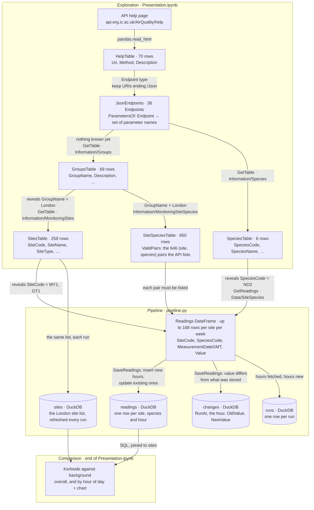

# London's air, on repeat: NO₂ beside a main road

## What I built and who for

**Audience:** people who walk, cycle or wait for buses along central London's main roads, and the people who
advise them.

**Question:** how much worse is the air right beside a busy road than nearby, and at what time of day?

**What I built:**

1. **An exploration of the API** ([Presentation.ipynb](Presentation.ipynb)). It starts from the API's help page and
   finds, by a rule, which endpoint gives the values another endpoint needs, until it reaches the hourly readings.
   Along the way it names the API's quirks and handles each one in one place.
2. **A pipeline** ([pipeline.py](pipeline.py)) that fetches the last 7 days of hourly NO₂ for two sites into DuckDB.
   Every run adds new hours, updates hours already stored, never duplicates, records any value that changed, and logs
   itself. It uses the notebook's rules and checks, and stops with an error rather than store a request that silently
   returned nothing.
3. **A comparison of the two sites** (end of [Presentation.ipynb](Presentation.ipynb)):
   - **Marylebone Road (MY1):** kerbside
   - **Station Walk (GT1):** urban background

   Both site types come from the API's site list, joined to the readings in SQL.

**Headline (17 Oct – 2 Nov 2026):** beside Marylebone Road, NO₂ averaged **3.6×** the background level, over the 320
hours when both sites had a reading. The gap is largest in the evening rush hour, at **17:00 GMT** (60.4 against
16.5 µg/m³), with a second peak in the morning rush hour.


## The data

The [London Air Quality Network API](https://api.erg.ic.ac.uk/AirQuality/help), run by the Environmental Research
Group. Readings are hourly, in µg/m³: the API's `Data/Wide/Site` endpoint labels its NO₂ column
"Nitrogen Dioxide (ug/m3)".

A reading the API doesn't have yet comes back as an empty string (`""`). The pipeline stores it as missing (NULL), and
a later run fills it in when the value arrives.

Everything unexpected we found about how the API behaves, and what the code does about each, is in
[Mess.md](Mess.md).

## How it works

Each box is a table and each arrow is the code that makes the next one. The notebook finds the path through the API.
`pipeline.py` repeats the last part of that path on every run.



### Where each step of the brief happens

| Step | Where | How |
|---|---|---|
| **Extract:** how the endpoints connect | [Presentation.ipynb](Presentation.ipynb) | The help page becomes a table of endpoints, and `ParametersOf` reads the parameters each one needs. Discovery then starts knowing nothing: call every endpoint whose parameters are all known (`CallableWith`), and see which parameters each reply gives values for (`Reveals`: a column named like a parameter). Repeat. Two rounds reach the readings: Groups gives GroupName, MonitoringSites gives SiteCode, Species gives SpeciesCode, and those three unlock `Data/SiteSpecies`. |
| **Collect history** | `pipeline.py`: `SaveReadings` | The `readings` table's primary key is site + species + hour, so each hour is stored once. A new hour is inserted. An hour we already have is updated (`ON CONFLICT … DO UPDATE`), which picks up late and corrected values. Before updating, any value that differs is written to `changes` with its old and new value. Each run re-fetches the last 7 days and adds a row to `runs`. |
| **Shape** | `Clean`, and the `readings` and `sites` tables | `Clean` removes the API's `@` from field names, so a field and the parameter it fills have one name, and turns `""` into a real missing value (NULL). The table's column types turn text into a timestamp and a number. The primary key says what one row is: one site, one species, one hour, and its value. `sites` joins to `readings` on `SiteCode`. |
| **Use** | end of [Presentation.ipynb](Presentation.ipynb) | Mean NO₂ at the kerbside and background sites over the hours where both have a value, overall and by hour of day. |

### Guarding against bad data

The API answers 200 with every value empty for a site that doesn't exist, for a pollutant a site doesn't measure, and
for one it has stopped measuring. None of these is an error, so nothing fails unless we check. A request passes
through several boundaries, and each could hold a check. Each line below is one boundary, the braces hold the
options, and ✓ marks what I chose:

```
Parameters     { nothing | format check | site is an open London site | (site, species) ∈ ValidPairs ✓ | dates within Started–Finished }
      ↓
The call       { catch everything | catch HTTPError and log it ✓ exploring | let it raise ✓ | retry }
      ↓
Reply content  { trust it | no values at all → raise ✓ | a threshold on % missing | a Pydantic model of the reply }
      ↓
Storage        { column types ✓ | primary key ✓ | CHECK constraints }
      ↓
Across runs    { upsert and a changes table ✓ | a runs log ✓ | last measured hour per site ✓ }
```

It takes two checks, because each catches what the other can't. Checking the request stops a site or pair the API
doesn't list, before the call. But listed doesn't mean it has data: Marylebone Road stopped measuring PM10 in 2019,
and has had no CO since 30 Oct 2026, though CO is still listed with no end date. Only checking the reply catches
those.

The API's other quirks each live in one named place. A quirk with a pattern becomes a rule: `Records` finds the
records in any reply, `AsList` handles a list of one coming back as a single object, and `Clean` handles `@` names and
`""` values. Where there is no pattern, the knowledge is written down as data: `RecordPaths` states where the records
are for the endpoints the pipeline relies on, and the notebook checks it against the live API. The notebook explores
with the rule; the pipeline follows the stated paths.

### Running it again

Running the pipeline twice in a row adds nothing the second time. Each run is logged in `runs`, and the
first real runs were on 1 and 2 Nov 2026. The week before that was loaded by replaying past dates, in my first
notebook (kept in the git history): it moved the end date forward one day at a time, starting a week back. The first
run added 336 hours (2 sites × 7 days × 24 hours). Each run after that added 48 (1 new day × 24 hours × 2 sites) and
left the rest as they were.

A replay uses today's version of past data, so it can't show a late value arriving. Real runs a few hours apart do:
the most recent hours are often empty at first and filled in later, and those show up in `changes`.

## How to run it

```bash
python -m venv .venv && source .venv/bin/activate        # Windows: .venv\Scripts\activate
pip install -r requirements.txt

python pipeline.py                                       # each run: fetch the last 7 days and save
```

Then open [Presentation.ipynb](Presentation.ipynb) and run it from the top: the exploration, the checks, and then the
history and the comparison, read from `air.duckdb`. The notebook only reads the database, and closes it at the end.
DuckDB lets only one program write to `air.duckdb` at a time, so close any open connection before running
`pipeline.py`.

## What I would do next

- **Measure how far back values change.** The pipeline assumes nothing older than 7 days changes. Re-fetching an
  older month and comparing it with what was stored would turn that assumption into a measured number.
- **Define the rules once.** The notebook defines `Get`, `AsList`, `Follow` and `Clean` as it discovers them, and
  `pipeline.py` repeats them. A small module both import would keep them from drifting apart.
- **A schedule (cron) instead of running it by hand,** and a visual, interactive version of the pipeline diagram.
- **More road / background pairs, and other pollutants,** to test whether the pattern holds across London.

## Where AI helped

*To be written by me, in my own words.*

---

Data: London Air Quality Network, Environmental Research Group ([londonair.org.uk](https://www.londonair.org.uk)),
used under the API's terms and conditions.
